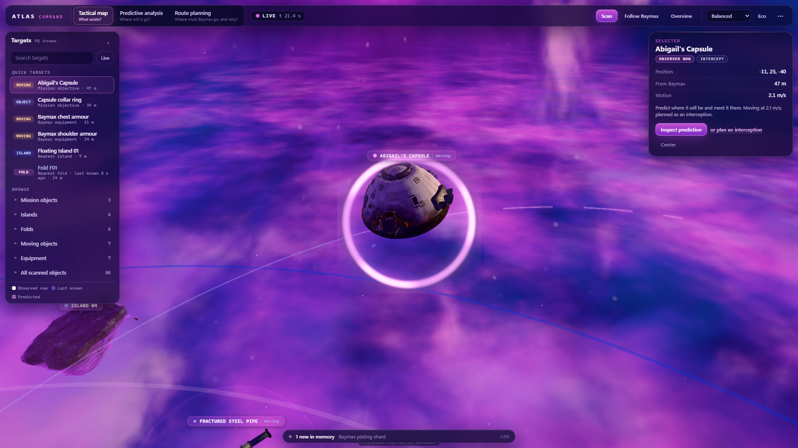
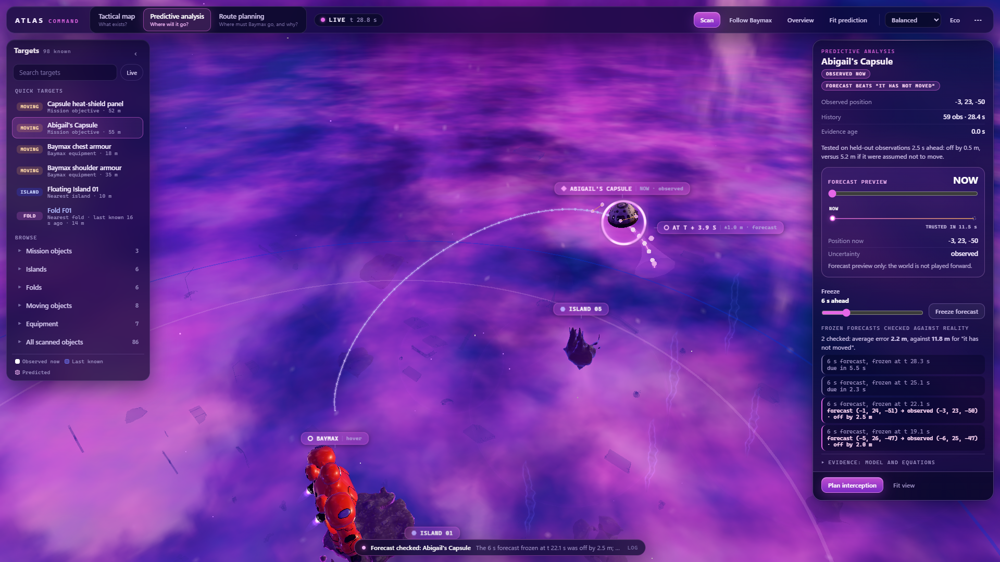
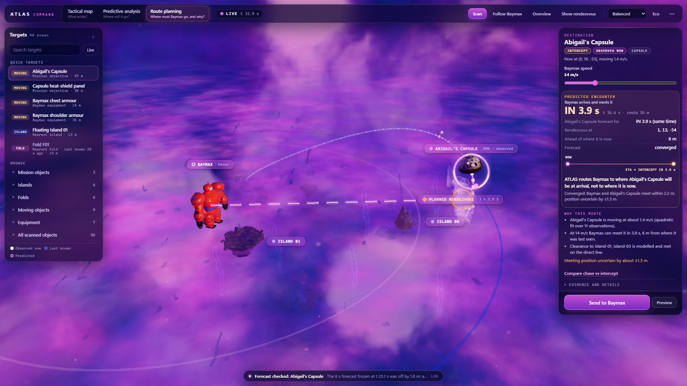
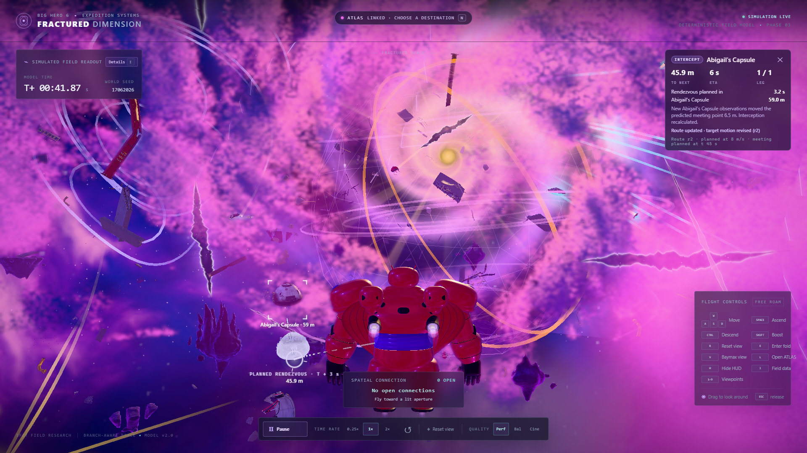

# Big Hero 6: Fractured — ATLAS Command

**Companion app: [Fractured Dimension](https://github.com/Aadit-issar/big-hero-6-fractured-dimension)** (clone both) · **[Judge guide](docs/JUDGE_GUIDE.md)**

**ATLAS Command is Baymax's navigation intelligence for a world that refuses to stay still.** It is linked to the *running* Fractured Dimension: it scans only what Baymax's sensors can legitimately see, remembers it, estimates how moving objects move, forecasts where they will be, plans a time-aware route (an interception for a moving capsule, an approach for wreckage and islands, an entrance route for a fold), sends that route to the Dimension, and replans when new observations change the picture.

| | |
|---|---|
|  |  |
|  |  |

## Role in Big Hero 6: Fractured

| | Dimension ([repo](https://github.com/Aadit-issar/big-hero-6-fractured-dimension)) | ATLAS Command (this repo) |
|---|---|---|
| Role | The world and the truth: field, folds, moving objects, Baymax's flight | Remembers, predicts, plans, explains |
| Port | `4183` | `5184` |

`DIMENSION → observations → ATLAS memory → prediction → planning → route → DIMENSION navigation → new observations`. ATLAS needs a running Dimension to be useful; a clearly labelled guided replay (`?experience=mission`) and a controlled challenge (`?experience=challenge`) also run without it.

## What is in this repository

- **ATLAS Command interface** with three modes: **Tactical map** (what exists?), **Predictive analysis** (where will it go?), **Route planning** (where must Baymax go, and why?).
- **Live scanning and observation**, **object memory** (current / remembered / predicted), **moving-object tracking**, **predictive interception**, **time-aware route planning**, **live navigation integration** with the Dimension.
- The two-way **bridge** implementation (`src/shared/liveLink.ts`, `src/atlas/command/session.ts`) and the 3D assets ATLAS draws (`src/atlas/lab/public/models/`, `public/assets/`).

## System requirements

- **Node.js 20.19+ or 22.12+** (Node 24 used in development) and the **npm** that ships with it. The lockfile is `package-lock.json`.
- A desktop browser with **WebGL2**: current **Chrome or Edge**. Keyboard and mouse. Allow pop-ups for `127.0.0.1`.
- A GPU that can render two WebGL windows at once; ATLAS has an **Eco** switch (map at 12 fps) and a 30 fps cap for this reason.
- The **Dimension repository** (separate clone). No other software, accounts, API keys or environment variables.
- Instructions are for Windows PowerShell; the npm commands are the same elsewhere.

## Install

```powershell
git clone https://github.com/Aadit-issar/big-hero-6-fractured-dimension.git
git clone https://github.com/Aadit-issar/big-hero-6-fractured-atlas.git
cd big-hero-6-fractured-atlas
npm ci
cd ..\big-hero-6-fractured-dimension
npm ci
```

(Clone both into the same parent folder if you want to use the launcher.)

## Run

**One command** (from this repository; installs missing dependencies, builds, serves both on loopback, opens the Dimension):

```powershell
cd big-hero-6-fractured-atlas
powershell -ExecutionPolicy Bypass -File scripts\start-live-demo.ps1
```

It expects the Dimension at `..\big-hero-6-fractured-dimension` (override with `-DimensionPath <dir>`), refuses to start if ports 4183 or 5184 are busy, and opens each server in its own PowerShell window. `-Dev` uses Vite dev servers instead of production builds.

**Manual** (two PowerShell windows; Dimension first):

```powershell
# Window 1
cd big-hero-6-fractured-dimension
npm run serve        # http://127.0.0.1:4183/
# Window 2
cd big-hero-6-fractured-atlas
npm run serve        # http://127.0.0.1:5184/
```

(`npm start` runs the dev servers on the same ports.) Then open

`http://127.0.0.1:4183/?quality=cinematic&view=baymax&atlas=http://127.0.0.1:5184/`

and press **L** in the Dimension: ATLAS opens in a second window already linked to that session. Alternatively open `http://127.0.0.1:5184/` and click **Open Dimension and connect**.

**Stop:** close the two PowerShell server windows, or press Ctrl+C in each.

## How to use

Full step-by-step: **[docs/JUDGE_GUIDE.md](docs/JUDGE_GUIDE.md)**. In short:

1. **Fly Baymax** in the Dimension: W/A/S/D, Space up, Ctrl down, Shift boost, click-drag to look, V toggles Baymax view.
2. **Scan** (button in ATLAS's header). Objects, islands and folds appear as they are observed; out-of-range ones stay as translucent *remembered* records.
3. **Tactical map**: browse/search the target list or click a marker; select **Abigail's Capsule** (the moving flagship target) or an island/fold/wreckage target.
4. **Predictive analysis**: history trail, the capsule now, and a translucent copy at the forecast position with an uncertainty volume; a scrubber previews future times; frozen forecasts are compared with what was later observed. A first forecast needs roughly 6–10 s of observation.
5. **Route planning**: choose **Baymax speed** with the slider (4–42 m/s; the plan recomputes instantly). The map shows the route, the forecast path, the **planned rendezvous** (or **aim point** when only a limited lead is trusted) and Baymax's arrival hologram, with the ETA and reasons.
6. **Send to Baymax** sends the route; **Preview** replays it in ATLAS only; **Cancel** withdraws it.
7. **In the Dimension**, follow the dashed 3D route, waypoint markers and rendezvous reticle. ATLAS replans as observations change and states why. The Dimension decides arrival or miss from true positions.

Select a fold to route to its entrance (where a fold leads is never inferred) or an island for a hover point above it.

## Connection between the applications

- **Transport:** browser `window.postMessage` between two windows (protocol v2). **No separate relay or WebSocket server runs.** Peers must be loopback origins.
- **Services that must stay open:** the Dimension server (4183), the ATLAS server (5184), and both browser windows. **One window must open the other** (**L** in the Dimension, or the connect button in ATLAS); separately opened tabs cannot find each other.
- **Baymax position:** the Dimension publishes pose, attitude, velocity and the simulation clock at 4 Hz; ATLAS's only notion of "now" is the simulation time of the newest frame. Paused or hidden Dimensions stop the clock and ATLAS says so.
- **Observations reach ATLAS** as sensor observations (islands and folds within 60 m) and proximity scans (objects with labels and attitudes, within range). Never velocities, parameters, future positions or the object registry; ATLAS must estimate motion itself from repeated observations.
- **Routes return to the Dimension** as validated `route` messages (revision, goal, mode, speed, up to 24 waypoints, interception data, a one-sentence reason). The Dimension acknowledges (`route-ack`), reports navigation progress, draws the route, and decides arrival itself. A route can never move Baymax.
- Link health: stale after 3.5 s, disconnected after 9 s without frames; records are then kept as last-known.

## Technical explanation

- **Dimension mathematics:** a seeded time-dependent scalar field Φ defines the map `X(q,t) = L·(q + α∇Φ)`; movers follow `q̈ = −k(q − g(t)) − c·q̇ − μ∇Φ + a_d` in reference space and are mapped through `X`; folds are compressed-map regions. See the Dimension README and [docs/MATHEMATICAL_MODEL.md](docs/MATHEMATICAL_MODEL.md).
- **Observation-based prediction** (`src/atlas/command/forecast.ts`): each moving object's track is fitted by rolling-origin-validated linear or quadratic polynomials compared against "has not moved"; spans are short (about 3–5 s) because the map multiplies curvature. The stated uncertainty is calibrated against ground truth in tests and widens with lead time (×1 to ×1.75 between 3 s and 6 s). Forecasts are frozen when issued and later scored against reality; a forecast that cannot be justified is withheld with a reason.
- **Time-aware routing** (`intercept.ts`, `route.ts`): solves for the meeting time `T` with `|P(T) − B₀| / v = T − t₀`, where `P` is the target estimate, then iterates `T` against a label-setting route planner with exact clearance from moving obstacles and island bubbles. Lead time is bounded to 6 s (refined as Baymax closes in); a pursuit fallback is used if the target outruns the exact solution. A replan policy issues a new route revision only for stated reasons (target moved ≥ max(3.5 m, 12 % of range), speed changed, off-route, mode changed, route aged).
- **Information boundary:** `src/atlas/command/` never imports the simulation or sensors; tests assert payloads carry no velocity or forecast fields.
- **Honest scope:** forecasts are local extrapolations with measured, finite skill (useful to about 6 s); against this slow capsule plain pursuit is about as fast as ATLAS, while ATLAS also avoids rock and explains itself. See [docs/ATLAS_LIVE_FINAL_ARCHITECTURE.md](docs/ATLAS_LIVE_FINAL_ARCHITECTURE.md) (sections 5–8, 12) and [docs/ATLAS_OVERHAUL.md](docs/ATLAS_OVERHAUL.md).
- **Architecture:** `src/atlas/command/` (session, world memory, forecast, targets, intercept, route, replan, camera, UI panels), `src/atlas/command/scene/` (Three.js tactical scene), `src/atlas/lab/` (entry point, assets), `src/shared/` (wire contract and asset manifest), `src/scene/`, `src/simulation/` (Dimension code shared for rendering the same sky/rock), `tests/`. Stack: React 19, TypeScript, Vite, Three.js, React Three Fiber. Developer commands: `npm run typecheck`, `npm test`.

## Troubleshooting

| Problem | Fix |
|---|---|
| `node`/`npm` not found, or Node version errors | Install Node 20.19+ or 22.12+, reopen PowerShell, check `node -v`. |
| Missing dependencies / `Cannot find module` | Run `npm ci` in **both** repositories. |
| `Port 4183`/`5184` already in use | Close the earlier server window, or find the owner with `Get-NetTCPConnection -LocalPort 5184`. The ports are fixed because each app defaults to the other's address. |
| Launcher says the Dimension repository is not found | Clone it next to this folder as `big-hero-6-fractured-dimension`, or pass `-DimensionPath`. |
| ATLAS says "Connect to the running Dimension" / "Waiting for the Dimension" | Press **L** in the Dimension or click **Open Dimension and connect**; allow pop-ups for `127.0.0.1`; use `127.0.0.1` (not `localhost`) in both; keep both servers running; wait 10–20 s while the Dimension builds terrain. Two independently opened tabs will not link. |
| ATLAS connected but no objects | Click **Scan**; fly toward objects (scan range is limited, 60 m, 100 m for the capsule's beacon). Make sure the Dimension tab is visible and not paused. |
| No forecast | Needs roughly 6–10 s of observations of the target; keep it within scan range and keep scanning. ATLAS states the reason. |
| Blank/black scene or WebGL error | Use current Chrome/Edge, enable hardware acceleration, update GPU drivers, enable **Eco**, use `quality=performance` in the Dimension URL, check `chrome://gpu`. |
| 3D models/textures missing | Reload; confirm `src/atlas/lab/public/models/` and `public/assets/` exist; open via the served URL, not from disk. |
| Route not appearing in the Dimension | Click **Send to Baymax** while connected (not "LINK LOST"); the Dimension HUD must be visible (**H**) and be the same session; reloading the Dimension discards old routes. |

## Third-party notices

- Surface textures: Poly Haven CC0 1.0 sets; see [docs/ASSET_PROVENANCE.md](docs/ASSET_PROVENANCE.md). All 3D models are original project geometry generated for this project, with procedural textures; some shapes were guided by AI-generated concept sheets.
- *Big Hero 6*, Baymax, Hiro and related names and characters belong to Disney. This is an independent, non-commercial fan project made for a competition; it is not affiliated with or endorsed by Disney. No licence is granted over those properties, and no open-source licence has been applied to this repository.
- Open-source dependencies keep their own licences (see `package-lock.json`).

## Start-up notice

On first launch a small, dismissible card reminds you that ATLAS Command and the Fractured Dimension are meant to be installed together from GitHub. It disappears automatically once the Dimension connects. **Got it** hides it for this visit, **Don't show again** remembers the choice in the browser, and `?pairNotice=0` suppresses it. It never blocks any other control.
